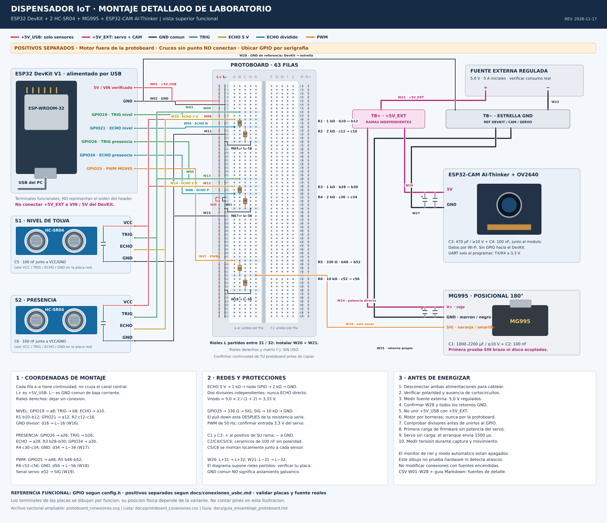
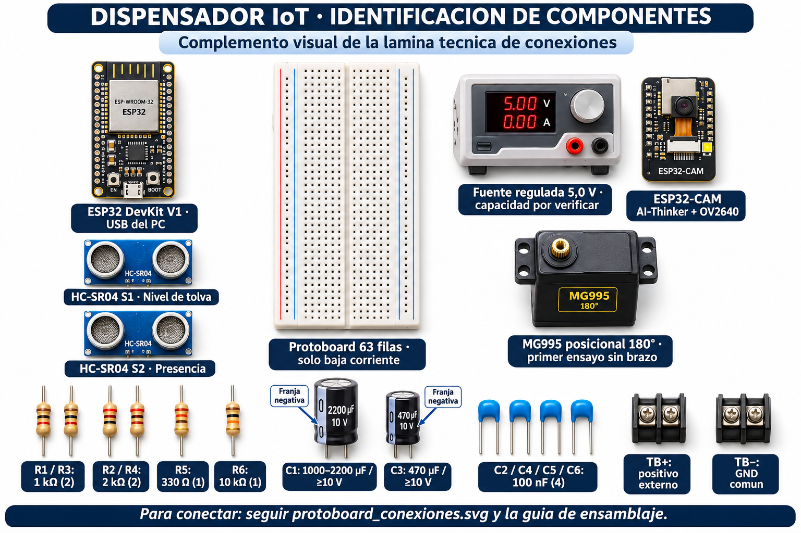

# Guía completa de ensamblaje físico y conexiones en protoboard

**Proyecto:** Dispensador inteligente de alimento para mascotas.  
**Fecha:** 17 de noviembre de 2026.  
**Base de revisión:** commit [`09bc1ae68957a2ef4f433d9fba9450c95883d991`](https://github.com/bryanramosing-ux/Proyecto-Dispensador-IOT/commit/09bc1ae68957a2ef4f433d9fba9450c95883d991).  
**Montaje:** ESP32 DevKit V1 + **dos HC-SR04** + MG995 posicional de 180° + ESP32-CAM AI-Thinker.

Esta guía consolida el pinout de [`config.h`](../ESP32/Dispensador_ESP32/config.h), la arquitectura de dos alimentaciones de [`conexiones_usbc.md`](conexiones_usbc.md) y el montaje de laboratorio descrito en [`manual_instrucciones_conexiones.md`](manual_instrucciones_conexiones.md). Algunos documentos heredados todavía mencionan un solo sensor o un sistema solar: no deben utilizarse para cambiar estas conexiones.

> **Regla de alimentación:** USB del PC → DevKit y ambos sensores, previa comprobación de capacidad. Fuente externa regulada de 5 V → MG995 y ESP32-CAM por ramas independientes. **Los positivos USB y externo NO se unen. Todos los GND comparten referencia.** La corriente del servo no circula por la protoboard ni por el DevKit.

El montaje físico todavía requiere validación. El firmware mantiene `USAR_DETECCION_AUTOMATICA=0`, `BOTON_DISPENSA_LOCAL=0`, `USAR_MONITOR_SERVO=0` y `USAR_MONITOR_BATERIA=0`. La cámara ofrece imágenes por Wi-Fi; no identifica automáticamente mascotas en el flujo activo. El PC debe permanecer encendido para backend, historial y dashboard. No se describe un dispositivo autónomo por visión ya validado.

## Láminas y archivos para seguir esta guía

- [Lámina técnica SVG ampliable](imagenes/protoboard_conexiones.svg): coordenadas, circuitos y redes de alimentación.
- [Lámina técnica PNG de 3600 × 3100 píxeles](imagenes/protoboard_conexiones.png): descargar para ampliar o imprimir.
- [Lista de conexiones CSV](protoboard_conexiones.csv): cables W01–W28, resistencias R1–R6 y condensadores C1–C6.
- [Ilustración de identificación de componentes](imagenes/componentes_identificacion.png): módulos y pasivos separados, sin cableado. Para conectar, seguir las coordenadas y tablas de la lámina técnica.
- [Generador de la lámina técnica](../Documentation/wiring/generar_protoboard_detallada.py): reproduce SVG y CSV y comprueba redes y GPIO del modelo.



**Cómo leer el dibujo:** los terminales del DevKit y la cámara se presentan por función; **no representan el orden físico de sus headers**. Localizar cada GPIO por la serigrafía de la placa real. Los cruces de líneas sin punto no son uniones. Los puntos en extremos indican contactos. La disposición de los dos grupos de cinco agujeros sí es la referencia de montaje de la protoboard.

## 1. Materiales y Componentes Requeridos

### 1.1. Electrónica, alimentación y herramientas

| ID / elemento | Cantidad | Especificación / función |
|---|---:|---|
| ESP32 DevKit V1 | 1 | ESP32-WROOM-32; confirmar variante y etiquetas. No extrapolar el pinout a ESP32-S3/C3 o Arduino UNO. |
| ESP32-CAM AI-Thinker | 1 | OV2640 y PSRAM; entrada de 5 V confirmada para la placa. |
| HC-SR04 S1 y S2 | 2 | S1: nivel de tolva. S2: presencia. Módulos de 5 V. |
| MG995 | 1 | Servo **posicional de 180°**, no de giro continuo. Verificar ficha de la unidad. |
| Fuente externa | 1 | Salida regulada de **5,0 V**; referencia inicial **5 A continuos**, a dimensionar con corriente de bloqueo y consumo reales; protección contra sobrecorriente. |
| Cable USB de datos del DevKit | 1 | USB-C o micro-USB según el conector real; alimentación y programación. |
| Programador de cámara | 1 | ESP32-CAM-MB o USB-TTL con UART de **3,3 V**. |
| R1 y R3 | 2 | **1 kΩ**, 1/4 W, preferiblemente 1 %. Resistencias superiores de los divisores ECHO. |
| R2 y R4 | 2 | **2 kΩ**, 1/4 W, preferiblemente 1 %. Resistencias inferiores de los divisores ECHO. |
| R5 | 1 | **330 Ω**, 1/4 W. Serie de señal PWM. |
| R6 | 1 | **10 kΩ**, 1/4 W. Pull-down de la señal del servo. |
| C1 | 1 | Electrolítico **1000–2200 µF**, tensión nominal **≥10 V**. Junto al servo. |
| C3 | 1 | Electrolítico **470 µF**, tensión nominal **≥10 V**. Junto a la cámara. |
| C2, C4, C5 y C6 | 4 | Cerámicos **100 nF**, tensión nominal ≥16 V. Servo, cámara y ambos sensores; sin polaridad. |
| Protoboard | 1 | Matriz de 63 filas y grupos a–e / f–j. Reservada para señales, divisores y alimentación de sensores. |
| TB+ y TB− | 2 bloques funcionales | Distribución positiva externa y estrella GND; borneras aptas para la corriente. Pueden ser bloques de varios terminales eléctricamente unidos. |
| Cable de potencia | Según recorrido | Cobre AWG20 como punto de partida para rama corta; aumentar sección si longitud, corriente o caída lo requieren. |
| Cable de señales y jumpers | Según tabla W01–W28 | Contactos firmes, identificados y aislados. No usar Dupont como alimentación principal del MG995. |
| Montaje | Según necesidad | Separadores, tornillería, arandelas, bridas, pasacables, termorretráctil y conectores con retención. |
| Instrumentos | — | Multímetro, calibre y balanza. Osciloscopio recomendable para ECHO, PWM y transitorios de alimentación. |
| Red y PC | 1 conjunto | Router/AP de 2,4 GHz y PC para backend/dashboard local. |

Los cuatro cerámicos incluyen desacoplo local adicional en servo y sensores. No aumentar indiscriminadamente la capacidad alimentada por USB: los electrolíticos grandes C1/C3 se sitúan en la **rama externa**, no en el riel USB de la protoboard.

Un SG90 no reemplaza directamente al MG995: cambian par, dimensiones, brazo y montaje. No conectar como sustituta la cámara denominada solamente “5110V0” sin identificar interfaz, tensión y pinout. No se montan panel solar, batería 2S, BMS, cargador ni convertidores del esquema solar anterior.

### 1.2. Piezas mecánicas

| Piezas del repositorio | Uso y revisión previa |
|---|---|
| 01 y 02 | Base y cuerpo; estabilidad y acceso de servicio. |
| 03 | Soporte del HC-SR04 de presencia: revisar dimensiones y orientación; documentación heredada puede marcarlo como excluido. Esta guía sí monta dos sensores. |
| 04 y 05 | Soportes de cámara y DevKit; verificar conectores y ventilación. |
| 06 | Soporte MG995; verificar orejas, tornillos y alineación del eje. |
| 07 y 13a | Tolva y tapa superior. |
| 08a, 08b, 08c, 08d | Carcasa, disco, placa superior de entrada y placa base de salida del dosificador. |
| 09, 10 y 11 | Conducto, salida y comedero. |
| 13b y 13c | Cápsula y tapa del sensor de nivel. |
| 14 y 15 | Tapa de servicio y separadores. |
| 16 | Adaptar si se utiliza: conserva geometría del cajón de energía antiguo. |

No imprimir la estación solar 12a/12b para este montaje. Las dimensiones reales del servo y sus clones mandan sobre las cotas del STL. Revisar [Mechanical](../Mechanical/README.md) y probar encajes antes de fabricar la estructura completa.

## 2. Esquema de Conexiones y Pinout

### 2.1. Arquitectura de potencia y referencia GND

```text
PC ── USB ── ESP32 DevKit
                ├── 5V_USB ───── L+ ─── VCC de S1 y S2
                ├── GND ──────── L− ─── GND de S1/S2 y divisores
                └── GND ── W28 ─────────────────────────────┐
                                                           │
Fuente externa 5,0 V                                        │
   + ── W22 ── TB+ ──┬── W24 ── MG995 V+                 │
                     └── W26 ── ESP32-CAM 5V              │
   − ── W23 ── TB− / ESTRELLA GND ◄───────────────────────┘
                         ├── W25 ── MG995 GND
                         └── W27 ── ESP32-CAM GND

No existe conexión entre TB+ y 5V_USB / VIN del DevKit.
DevKit y cámara se comunican por Wi-Fi; no unir sus GPIO.
```

**GND común es obligatorio:** W28 fija la referencia de la señal PWM entre fuentes. La corriente de motor entra por W24 y sale por W25; no debe pasar por W28, W02, la placa ESP32 o los contactos de la protoboard.

### 2.2. Pinout del controlador y módulos

| Dispositivo | Terminal | Conexión | Precaución |
|---|---|---|---|
| DevKit | USB | PC | Alimentación y programación; sin positivo externo a VIN/5V. |
| DevKit | 5V/VIN | L+5 por W01 | Usar como salida USB de 5 V solo después de comprobar el circuito de la variante. |
| DevKit | GND | L−6 por W02 y TB− por W28 | Común con las dos alimentaciones. |
| S1 nivel | VCC | L+10 por W08 | 5 V desde USB verificados. |
| S1 nivel | GND | L−14 por W11 | GND del DevKit y común. |
| S1 nivel | TRIG | GPIO19 por fila 8 | W03: GPIO19→a8; W09: TRIG→b8. |
| S1 nivel | ECHO | GPIO21 por R1/R2 | ECHO→a10; R1 b10–b12; GPIO21→a12. |
| S2 presencia | VCC | L+28 por W12 | 5 V desde USB verificados. |
| S2 presencia | GND | L−36 por W15 | Evita ocupar el agujero L−32 del puente W21. |
| S2 presencia | TRIG | GPIO26 por fila 26 | W05: GPIO26→a26; W13: TRIG→b26. |
| S2 presencia | ECHO | GPIO34 por R3/R4 | ECHO→a28; R3 b28–b30; GPIO34→a30. |
| MG995 | V+ | TB+ por W24 | Rama de potencia externa; nunca protoboard o DevKit. |
| MG995 | GND | TB− por W25 | Retorno propio al punto común. |
| MG995 | Señal | GPIO25 por R5 | GPIO25→a48; R5 b48–b52; e52→señal. R6 c52–c56 a GND. |
| ESP32-CAM | 5V | TB+ por W26 | Entrada de 5 V confirmada para la placa real. |
| ESP32-CAM | GND | TB− por W27 | Retorno propio. |
| OV2640 | Flex FPC | Conector de ESP32-CAM | Insertar y asegurar sin alimentación. |

GPIO34 es solo entrada y no dispone de pull-up/pull-down interno. Los sensores usan los GPIO del **DevKit**, no los números iguales de la ESP32-CAM. GPIO0 y GPIO2 se mantienen para BOOT/LED. GPIO32 y GPIO35 permanecen libres porque los monitores de tensión están desactivados. No reutilizar los pines internos de cámara, PSRAM o flash.

### 2.3. Cómo interpretar la protoboard

1. Con la placa orientada como en la lámina, las filas van de 1 a 63, de arriba abajo.
2. En cada fila, los cinco agujeros **a–e están unidos**. Los cinco **f–j están unidos entre sí**, separados de a–e por el canal central.
3. Filas distintas no están unidas. Por ejemplo, b10 y b12 solo quedan conectadas a través de R1.
4. Los rieles laterales son independientes de la matriz. L+10 no está unido a a10 por compartir el número 10.
5. La lámina presupone rieles partidos entre 31 y 32. Instalar **W20: L+31→L+32** y **W21: L−31→L−32**. Comprobar con multímetro dónde está el corte en la protoboard real; adaptar si difiere.
6. Los rieles derechos y el grupo f–j quedan sin uso. No llevar allí +5V_EXT: mantener la potencia externa en borneras.
7. No introducir dos cables en un agujero. Las terminaciones asignadas en el dibujo ocupan agujeros distintos; si falta espacio, cambiar a otro agujero del mismo grupo con continuidad comprobada.

El ESP32 se representa fuera de la protoboard para evitar que una variante ancha tape sus agujeros o produzca conexiones accidentales. Utilizar jumpers desde pines identificados por serigrafía.

### 2.4. Dos divisores ECHO independientes

```text
S1.ECHO ── a10/b10 ── R1 1 kΩ ── b12/a12 ── GPIO21
                                      │
                                   c12 · R2 2 kΩ · c16/d16 ── W16 ── L−16

S2.ECHO ── a28/b28 ── R3 1 kΩ ── b30/a30 ── GPIO34
                                      │
                                   c30 · R4 2 kΩ · c34/d34 ── W17 ── L−34
```

La resistencia de 1 kΩ va entre ECHO y el nodo del GPIO; la de 2 kΩ va desde ese nodo a GND. Con ECHO a 5,0 V:

```text
V_GPIO = 5,0 V × 2 kΩ / (1 kΩ + 2 kΩ) ≈ 3,33 V
```

No invertir las resistencias, unir ambos ECHO ni conectar ECHO directamente al ESP32. Usar resistencias de tolerancia conocida y verificar la amplitud con la alimentación real; el divisor no protege contra una fuente de tensión arbitraria. TRIG se excita a 3,3 V: confirmar que la variante del sensor acepta ese nivel.

**Verificación sin arriesgar el GPIO:** desconectar el cable al GPIO y el ECHO del sensor; aplicar temporalmente 5,0 V al extremo superior del divisor, usando el mismo GND, y medir el nodo. Retirar la conexión de prueba antes de restaurar ECHO. No aplicar una tensión externa sobre una salida ECHO conectada. Para la señal pulsada real usar osciloscopio: el multímetro puede mostrar promedio y ocultar el máximo.

### 2.5. Señal PWM, resistencias y condensadores

```text
GPIO25 ── a48/b48 ── R5 330 Ω ── b52/e52 ── W19 ── MG995.SIG
                                      │
                                c52 · R6 10 kΩ · c56/d56 ── W18 ── L−56
```

R6 está en el **lado del servo después de R5**. R5 limita transitorios en señal; no alimenta el motor ni convierte niveles. Verificar que la unidad admite señal de 3,3 V. Si requiere 5 V, rediseñar esa interfaz con un buffer 3,3→5 V adecuado antes de continuar; no elevar la tensión del GPIO.

| ID | Terminales | Colocación y polaridad |
|---|---|---|
| C1 1000–2200 µF | MG995 V+ / GND | Electrolítico, + a V+ y − a GND, cerca del conector del servo. |
| C2 100 nF | MG995 V+ / GND | En paralelo con C1; sin polaridad. |
| C3 470 µF | CAM 5V / GND | Electrolítico, + a 5V y − a GND, junto a cámara. |
| C4 100 nF | CAM 5V / GND | En paralelo con C3; sin polaridad. |
| C5 100 nF | S1 VCC / GND | Local al sensor de nivel. |
| C6 100 nF | S2 VCC / GND | Local al sensor de presencia. |

Los condensadores se conectan **en paralelo**, no en serie. La marca lateral del electrolítico suele identificar el terminal negativo: confirmar el componente. C1/C3 no deben alimentarse desde L+.

### 2.6. Lista completa de cables

| ID | Desde | Hasta | Función |
|---|---|---|---|
| W01 | DevKit 5V verificado | L+5 | Positivo USB para sensores. |
| W02 | DevKit GND | L−6 | Referencia de protoboard. |
| W03 | GPIO19 | a8 | TRIG nivel. |
| W04 | GPIO21 | a12 | ECHO nivel reducido. |
| W05 | GPIO26 | a26 | TRIG presencia. |
| W06 | GPIO34 | a30 | ECHO presencia reducido. |
| W07 | GPIO25 | a48 | PWM antes de R5. |
| W08 | S1 VCC | L+10 | Alimentación nivel. |
| W09 | S1 TRIG | b8 | Disparo nivel. |
| W10 | S1 ECHO | a10 | ECHO de 5 V antes de R1. |
| W11 | S1 GND | L−14 | Retorno nivel. |
| W12 | S2 VCC | L+28 | Alimentación presencia. |
| W13 | S2 TRIG | b26 | Disparo presencia. |
| W14 | S2 ECHO | a28 | ECHO de 5 V antes de R3. |
| W15 | S2 GND | L−36 | Retorno presencia. |
| W16 | d16 | L−16 | GND de R2. |
| W17 | d34 | L−34 | GND de R4. |
| W18 | d56 | L−56 | GND de R6. |
| W19 | e52 | MG995 SIG | PWM después de R5. |
| W20 | L+31 | L+32 | Puente de riel positivo USB. |
| W21 | L−31 | L−32 | Puente de riel GND. |
| W22 | Fuente externa + | TB+ entrada | Potencia; fuera de protoboard. |
| W23 | Fuente externa − | TB− entrada | Retorno; fuera de protoboard. |
| W24 | TB+ salida servo | MG995 V+ | Potencia propia. |
| W25 | TB− salida servo | MG995 GND | Retorno propio. |
| W26 | TB+ salida cámara | ESP32-CAM 5V | Rama propia. |
| W27 | TB− salida cámara | ESP32-CAM GND | Retorno propio. |
| W28 | DevKit GND | TB− referencia | GND común entre fuentes. |

Dos cables en el terminal GND del DevKit requieren un conector/distribuidor de baja corriente apropiado; no forzar dos conductores en un conector Dupont. TB+ y TB− necesitan terminales suficientes y contactos unidos explícitamente: dos bornes vecinos no siempre están conectados internamente.

### 2.7. Programación de ESP32-CAM

La conexión de programación no forma parte del cableado permanente de la lámina. Para USB-TTL con la cámara alimentada externamente:

| Adaptador USB-TTL | ESP32-CAM | Condición |
|---|---|---|
| TX de 3,3 V | U0R / RX0 | Señales cruzadas. |
| RX compatible con 3,3 V | U0T / TX0 | Nunca UART de 5 V. |
| GND | GND común | Obligatorio aunque las alimentaciones sean separadas. |
| Pin 5V / 3V3 de alimentación | Sin conectar | La cámara ya recibe su rama externa. |
| Puente temporal | GPIO0 → GND | Solo para arrancar en modo de carga. |

1. Desconectar fuentes y conectar TX, RX y GND. El nivel UART debe ser 3,3 V aunque la placa reciba 5 V en su entrada de potencia.
2. Colocar GPIO0 a GND y arrancar/reiniciar para cargar el firmware de AI-Thinker con PSRAM.
3. Al terminar, apagar ambas alimentaciones antes de retirar el puente o modificar cables. Retirar GPIO0–GND y reiniciar para funcionamiento normal.
4. Si se usa ESP32-CAM-MB, revisar su circuito: no enchufar su USB y el positivo externo simultáneamente sin verificar aislamiento.

## 3. Guía de Ensamblaje Físico Paso a Paso

### 3.1. Preparación mecánica y electrónica

1. **Desenergizar e identificar.** Retirar USB, apagar y desconectar la salida externa. Comprobar modelos, etiquetas, polaridad y conectores. Esperar la descarga de condensadores antes de medir resistencia o continuidad.
2. **Medir encajes.** Presentar MG995, sensores, placas y conectores con calibre. No forzar los módulos para que entren en un STL. Corregir soportes que compriman PCB o flex.
3. **Montar base y cuerpo.** Fijar 01/02 sobre una superficie estable; presentar conducto 09, salida 10 y comedero 11. Comprobar acceso de limpieza, ventilación y tapa de servicio.
4. **Presentar el dosificador sin servo acoplado.** Instalar placa base 08d y carcasa 08a; probar disco 08b y placa superior 08c. La entrada de la tolva corresponde a la placa superior y la salida al conducto a la placa base. Quitar rebabas y comprobar libertad del disco antes de unirlo al eje.
5. **Instalar soporte de servo y placas.** Fijar soporte 06 sin deformarlo; mantener el brazo retirado. Usar separadores para DevKit/cámara y dejar accesibles USB, BOOT y RESET. Ningún tornillo debe tocar pistas.
6. **Preparar distribución de potencia.** Instalar TB+ y TB− en compartimento seco y separado del alimento. Llevar W22/W23, pero dejar la fuente apagada y desconectada. Confirmar que TB+ no toca L+ ni VIN.

### 3.2. Cableado y pruebas por etapas

7. **Conectar los GND con todo apagado.** Preparar W28 DevKit→TB−, W02 DevKit→L− y los retornos propios de servo/cámara W25/W27. Conectar los GND de sensores W11/W15. Comprobar continuidad de referencia; no transportar corriente de motor por el DevKit o protoboard.
8. **Preparar la protoboard.** Identificar rieles y corte real con multímetro; instalar W20/W21. Montar R1–R6 en sus agujeros exactos y W16–W18 a GND. Medir resistencias y verificar que ninguna está puenteada accidentalmente en una sola fila.
9. **Cablear sensores.** Instalar VCC, GND, TRIG y ECHO de S1/S2 según W08–W15. Añadir C5/C6 localmente. Etiquetar ambos mazos para evitar intercambiarlos al montar la tapa.
10. **Comprobar divisores antes de conectar GPIO.** Seguir la prueba de 2.4 con GPIO y salida ECHO desconectados. Retirar la conexión temporal de 5 V; restaurar ECHO y conectar W04/W06 cuando el nodo sea correcto. Revisar también W03/W05.
11. **Primera carga del DevKit.** Mantener potencia y señal del servo físicamente desconectadas. Alimentar únicamente DevKit y sensores por USB. Configurar `secrets.h`, cargar firmware y abrir monitor serie a 115200. Mantener modo automático y botón de dosis desactivados. Comprobar que el pin usado para sensores entrega los 5 V previstos sin calentamiento o caída.
12. **Probar los sensores por separado.** Usar `NIVEL` con distancias conocidas para S1. S2 necesita una prueba específica de medición porque su rutina de presencia no se inicia con `USAR_DETECCION_AUTOMATICA=0`; no activar el ciclo automático de dispensación solo para verificar el cableado. Si ambos sensores se disparan en una prueba, hacerlo secuencialmente, dejando al menos 60 ms entre disparos y evitando ecos cruzados.
13. **Probar la cámara.** Apagar USB/fuente antes de cablear o programar. Confirmar GND común mediante W28/W27, entrada 5V correcta y C3/C4. Programar según 2.7 y probar `/status`, `/capture` y `/stream` en la LAN. No continuar si aparecen reinicios de alimentación.
14. **Preparar el servo sin carga.** Apagar ambas alimentaciones. Verificar colores de la unidad, instalar C1/C2 y conectar W24/W25, R5/R6 y W19. Confirmar otra vez GND común con DevKit. Mantener brazo y disco desacoplados.
15. **Primer movimiento supervisado.** Habilitar la alimentación externa antes de iniciar las señales del DevKit; no aplicar PWM a un servo sin alimentar. Al iniciar el firmware, se envía **1500 µs durante aproximadamente 800 ms**: el eje puede moverse sin un pedido de dosis. Comenzar por `SERVO 1500` y cambios de 50 µs alrededor del centro; parar ante golpes, zumbido sostenido o calentamiento. No barrer directamente 500–2500 µs: los límites del software no garantizan el recorrido físico de tu unidad.

### 3.3. Montaje definitivo y calibración

16. **Acoplar en cerrado.** Posicionar el servo, apagar USB y fuente y montar el brazo sin desplazar el eje. Fijar el disco con su bolsillo entre entrada y salida, sin comunicación de paso de alimento. No girar el eje a la fuerza ni apretar tornillos hasta deformar las placas.
17. **Montar nivel en la tapa.** Fijar S1 en 13b/13c mirando verticalmente hacia el alimento. Dejar inicialmente **≥3 cm** entre transductores y marca MAX; evitar que soporte, paredes o embudo generen el eco dominante. Las distancias por defecto de 3 y 15 cm son provisionales, no medidas reales.
18. **Montar presencia y cámara.** Orientar S2 hacia la zona de aproximación, evitando medir permanentemente el comedero. Verificar el encaje del soporte 03. Orientar la cámara sin flex forzado y mantener libre su antena. Las posiciones finales se determinan con pruebas en la estructura real.
19. **Sujetar e inspeccionar cableado.** Llevar positivo y retorno del servo juntos, separados de ECHO y otros cables de señal. Sujetar mazos con alivio de tracción; proteger pasos por bordes. Dejar un bucle de servicio para retirar la tapa sin arrancar cables. Ningún conductor o tornillo debe entrar en el disco o canal de alimento.
20. **Calibrar sin alimento.** Verificar cerrado, llenado y descarga con cambios graduales. Sustituir en `config.h` los pulsos provisionales por los obtenidos. Confirmar que el estado cerrado no depende de mantener fuerza contra un tope. Al cesar PWM el servo sigue alimentado y el mecanismo puede moverse por carga: comprobar cierre mecánico y fugas.
21. **Calibrar nivel y dosis.** Con la tolva vacía ejecutar `NIVEL VACIO`; con alimento hasta MAX, `NIVEL LLENO`. Probar pocas croquetas primero y pesar las entregas. Para `CICLO`, usar temporalmente `MODO_FERIA=1`, solo en calibración supervisada; después volver a 0. Las posiciones 1000/1500/2000 µs no son datos de fábrica ni garantía de porción.
22. **Validar integración.** Probar cámara capturando mientras el servo mueve el mecanismo. Medir tensiones en cargas, corriente y calentamiento; comprobar reinicios, recuperación Wi-Fi y varios ciclos. Repetir dosificación con tolva llena, media y baja; registrar al menos 10 muestras por condición como evaluación inicial.
23. **Cerrar y limpiar.** Cerrar solo después de superar las verificaciones eléctricas y mecánicas. Separar físicamente comida, humedad y electrónica. Utilizar recipiente/superficies removibles adecuados para alimento; una impresión FDM no es apta para alimentos solo por ser PETG. No permitir acceso de mascotas a piezas móviles durante pruebas.

## 4. Consideraciones de Alimentación y Energía

### 4.1. Por qué no alimentar el motor desde 5V/3V3 de la placa

El MG995 puede demandar picos de varios amperios durante arranque, inversión o bloqueo; la cifra exacta depende de variante, tensión y carga. El regulador de 3,3 V, las pistas, la ruta USB y los conectores del DevKit no constituyen una fuente de potencia para ese motor.

Alimentarlo desde esos puntos puede causar caída de tensión, brownout, reinicios, calentamiento o daños en placa, cable o puerto USB. **El GPIO entrega señal; W24/W25 entregan potencia desde la fuente externa.** Tampoco usar un pin de alimentación de la ESP32-CAM para alimentar el servo.

### 4.2. Presupuesto de corriente y tensión

Dimensionar la fuente externa con ficha o medición válida de la unidad:

```text
I_fuente ≥ 1,25 × (I_bloqueo_MG995 + I_pico_ESP32-CAM)
```

El 25 % es un margen inicial de diseño, no una certificación. El consumo del DevKit y de ambos sensores corresponde al presupuesto USB independiente. No dimensionar con el consumo del servo en reposo. No mantener el eje bloqueado deliberadamente para hacer una medición prolongada.

Verificar también corriente admisible de cables, borneras, interruptor y conectores. Una etiqueta de 5 A no compensa un cable fino o un conector de alta resistencia. Si la fuente emplea USB-C, confirmar capacidad real de fuente, cable y adaptador; el tipo de conector no garantiza 5 A.

La salida se ajusta a **5,0 V**. No elevarla a 6 V para obtener más par: la cámara comparte el positivo externo de este diseño. La tensión en el servo durante movimiento debe mantenerse dentro de la ficha de la unidad; los umbrales de error provisionales del firmware no sustituyen ese requisito.

Si el pin 5V del DevKit no puede alimentar los dos sensores de forma estable, detener y revisar la ruta USB. Una futura alimentación externa de sensores requiere rediseñar y documentar el cambio; nunca resolverlo puenteando L+ con TB+.

### 4.3. Tierras comunes y separación de retornos

La separación de positivos/ramas y el GND común reducen acoplamiento por impedancias compartidas. **No hay aislamiento galvánico** en este esquema.

- W25 lleva corriente de servo directamente a TB−.
- W27 lleva corriente de cámara directamente a TB−.
- W28 referencia DevKit con la fuente externa, sin ser el retorno principal del motor.
- W02 y L− sirven sensores, divisores y señal, con baja corriente.

No encadenar el retorno como `servo → cámara → DevKit → fuente`. Sin W28 o referencia equivalente verificada, la señal PWM puede interpretarse erráticamente y circular por rutas no previstas.

Si tras corregir distribución y cableado se necesita una fuente adicional exclusiva para servo, unir **su negativo** al punto común GND; mantener separados sus positivos. Actualizar lámina, CSV y guía antes de aplicar esa variante.

### 4.4. Caída de tensión, desacoplo y protección

```text
Caída de tensión = I × (R_ida + R_retorno + R_contactos)
```

Medir en terminales del MG995 y de cámara durante el funcionamiento, además de medir en la fuente. Usar recorridos cortos y sección adecuada; AWG20 es una referencia inicial, no un calibre universal. Comprobar consumo y temperatura de conectores bajo la carga prevista.

C1/C3 ayudan ante transitorios breves y C2/C4/C5/C6 al desacoplo local. No sustituyen una fuente suficiente ni un buen retorno. Para detectar caídas rápidas, el osciloscopio es más útil que un multímetro lento. No desactivar brownout para ocultar reinicios.

El esquema histórico excluye su fusible de 4 A. Esa exclusión no proporciona protección: usar una fuente protegida y limitar energía de fallo. Si la protección de la fuente no protege el cableado empleado, rediseñar la protección antes de energizar; no añadir un fusible con valor arbitrario. Mantener acceso al corte físico de alimentación externa.

**Medición de corriente:** conectar el multímetro en serie, en la entrada y escala apropiadas, con cables aptos y siguiendo sus límites. Nunca poner el amperímetro directamente entre +5 V y GND. No medir resistencia/continuidad con fuentes conectadas.

### 4.5. Límites de protección del firmware

`USAR_MONITOR_SERVO=0`: el montaje no confirma eléctricamente pérdida de riel, bloqueo ni masa entregada. La opción prevista en GPIO32 requiere un divisor adicional y calibración que **no forman parte de esta lámina**. Mantener GPIO32/35 sin conectar aquí.

`liberar()` retira PWM; **no desconecta la potencia del MG995**. No es un corte de emergencia ni una garantía frente a atasco. Supervisar el servo, mantener corte físico accesible y no permitir funcionamiento sin validar mecánica y alimentación.

## 5. Checklist de Verificación Previa al Primer Encendido

### 5.1. Sin alimentación

- [ ] Identificados DevKit, ESP32-CAM AI-Thinker, dos HC-SR04 y MG995 posicional.
- [ ] Fuente, cables y conectores dimensionados para picos de carga y fallos.
- [ ] Fuente medida en vacío a 5,0 V antes de conectarla a los módulos.
- [ ] USB y fuente externa desconectados para revisar continuidad; condensadores descargados.
- [ ] Ausencia de cortocircuito sostenido entre positivos y GND; considerar transitorio de carga de condensadores.
- [ ] TB+ y L+ / VIN del DevKit sin unión directa.
- [ ] W28 une DevKit GND a TB−; todos los módulos comparten GND.
- [ ] W24/W25 transportan potencia del servo fuera de protoboard/DevKit.
- [ ] W26/W27 proporcionan una rama propia a la cámara.
- [ ] Rieles reales identificados y puentes W20/W21 comprobados.
- [ ] R1/R3 de 1 kΩ hacia ECHO; R2/R4 de 2 kΩ hacia GND.
- [ ] ECHO S1 llega a GPIO21 y ECHO S2 a GPIO34 después de sus divisores.
- [ ] TRIG S1 a GPIO19; TRIG S2 a GPIO26; PWM a GPIO25.
- [ ] R5 de 330 Ω en serie; R6 de 10 kΩ entre señal del lado servo y GND.
- [ ] No hay 5 V directos a GPIO, 3V3 ni UART del ESP32.
- [ ] C1/C3 con polaridad correcta, tensión nominal suficiente y en ramas externas.
- [ ] C2/C4/C5/C6 instalados localmente; ninguna pata produce un puente accidental.
- [ ] Programador UART a 3,3 V y sin positivo unido a fuente externa.
- [ ] GPIO0 de cámara libre de GND para funcionamiento normal.
- [ ] Servo sin brazo/disco para su primera prueba; espacio libre para movimiento de arranque.
- [ ] Cables sujetos y aislados; ningún tornillo toca PCB o mecanismo.
- [ ] Acceso inmediato para cortar alimentación externa.

### 5.2. Encendido por etapas y aceptación

| Etapa | Comprobación | Resultado mínimo para avanzar |
|---|---|---|
| DevKit por USB | Inicio y 5 V de sensores | Sin calentamiento ni caída anormal; firmware correcto. |
| Divisores y sensores | Nodo ECHO, distancias conocidas y GND | Nivel compatible con GPIO y lecturas repetibles. |
| Cámara externa | Estado, captura y stream | Funciona con la placa física, sin brownout. |
| Servo desacoplado | Centro, cambios pequeños, tensión/corriente | Sin topes, vibración sostenida, caída fuera de ficha o calentamiento anormal. |
| Mecánica vacía | Cerrado/llenado/descarga | Movimiento libre y cierre sin presión contra un tope. |
| Pocas croquetas | Masa, atascos y fugas | Entrega reproducible; sin giro forzado ni paso continuo de alimento. |
| Integración | Cámara y servo simultáneos | Sin reinicios, tensión estable y conectores sin calentamiento. |

Ante olor, calentamiento rápido, ruido mecánico sostenido, reinicios o tensión fuera de especificación: cortar la fuente externa y USB, localizar la causa y corregir antes de repetir.

### 5.3. Registro de validación física

| Parámetro | Medida / observación |
|---|---|
| Modelo y corriente nominal de la fuente | Pendiente |
| Variante y ficha del servo | Pendiente |
| Tensión externa en vacío | Pendiente |
| Mínimo en servo durante movimiento/carga prevista | Pendiente |
| Mínimo en cámara durante captura + movimiento | Pendiente |
| Pico de corriente observado y método de medida | Pendiente |
| Máximo ECHO reducido S1/S2 y método de medida | Pendiente |
| Pulsos reales cerrado/llenado/descarga | Pendiente |
| Distancias de tolva vacía/llena | Pendiente |
| Masa y dispersión de dosis con nivel alto/medio/bajo | Pendiente |
| Temperatura ambiente y de fuente/cables/servo | Pendiente |
| Reinicios, atascos y fugas observados | Pendiente |
| Firmware, fecha, responsable y evidencias | Pendiente |

No declarar seguro para operación autónoma o uso con mascotas mientras estas pruebas estén pendientes. Las verificaciones de software o del dibujo no miden corriente, temperatura ni gramos reales.

## Anexo A. Identificación visual de componentes



La ilustración sirve para reconocer módulos y pasivos; muestra piezas desconectadas. Para posiciones de agujeros, valores y conexiones exactas, utilizar la lámina SVG/PNG técnica, las tablas y el CSV. Verificar siempre la serigrafía de la variante real de placa; la apariencia y la cantidad de terminales disponibles pueden variar.

## Anexo B. Reproducir y revisar la lámina técnica

Desde la raíz del repositorio, con Python 3:

```bash
python3 Documentation/wiring/generar_protoboard_detallada.py
```

El generador usa solo biblioteca estándar. Revisa GPIO de `config.h`, continuidad modelada de grupos a–e/f–j y rieles partidos, ausencia de agujeros duplicados en cables/resistencias, GND común, positivos separados y ausencia de conexión metálica directa de ECHO al GPIO. No reemplaza una revisión física ni verifica el pinout del fabricante.

Para exportar PNG con Inkscape instalado:

```bash
inkscape docs/imagenes/protoboard_conexiones.svg --export-type=png --export-filename=docs/imagenes/protoboard_conexiones.png
```

Si se modifica una coordenada o componente, regenerar SVG/CSV/PNG y actualizar las tablas de esta guía. Los generadores antiguos de `Documentation/wiring/` no son la fuente de esta lámina y conservan las limitaciones documentadas en `docs/conexiones_usbc.md`.

## Referencias del proyecto

- [Configuración de pines y opciones](../ESP32/Dispensador_ESP32/config.h).
- [Inicialización y control del servo](../ESP32/Dispensador_ESP32/Dosificador.cpp).
- [Conexiones USB y fuente externa](conexiones_usbc.md).
- [Manual de laboratorio](manual_instrucciones_conexiones.md).
- [Firmware de cámara](../ESP32_CAM/README.md).
- [Piezas y limitaciones mecánicas](../Mechanical/README.md).
- [Pruebas](pruebas.md) y [calibración](../Documentation/calibration/calibracion.md).
